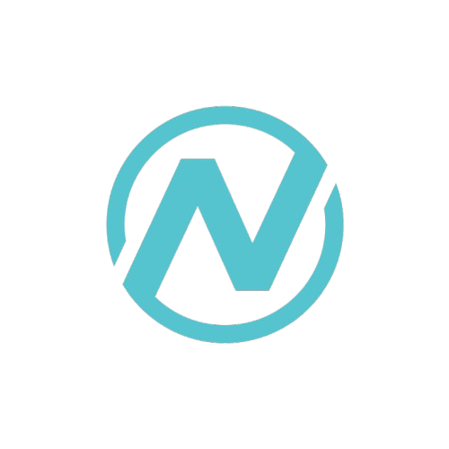

# How to Replace PNG Logo with SVG in Hero.tsx

## Step 1: Add Import
At the top of `Hero.tsx` (line 1), change:
```tsx
import { ArrowRight, Play, ChevronDown, Code, Cpu, Zap, Brain } from 'lucide-react';
```

To:
```tsx
import { ArrowRight, Play, ChevronDown, Code, Cpu, Zap, Brain } from 'lucide-react';
import StarAILogo from './StarAILogo';
```

## Step 2: Replace the Image
Find lines 600-610 in `Hero.tsx` that contain:
```tsx
{/* Logo Image */}
 {
    e.currentTarget.style.display = 'none';
    const nextElement = e.currentTarget.nextElementSibling as HTMLElement;
    if (nextElement) nextElement.style.display = 'flex';
  }}
/>
```

Replace with:
```tsx
{/* Logo SVG */}
<StarAILogo className="relative w-10 h-10" />
```

## Done!
The SVG logo component is already created at `frontend/src/components/StarAILogo.tsx` and features:
- Professional gradient "N" letter design
- Blue/cyan colors matching your theme
- Glow effects for premium look
- Star accent above the letter
- Fully scalable and lightweight
